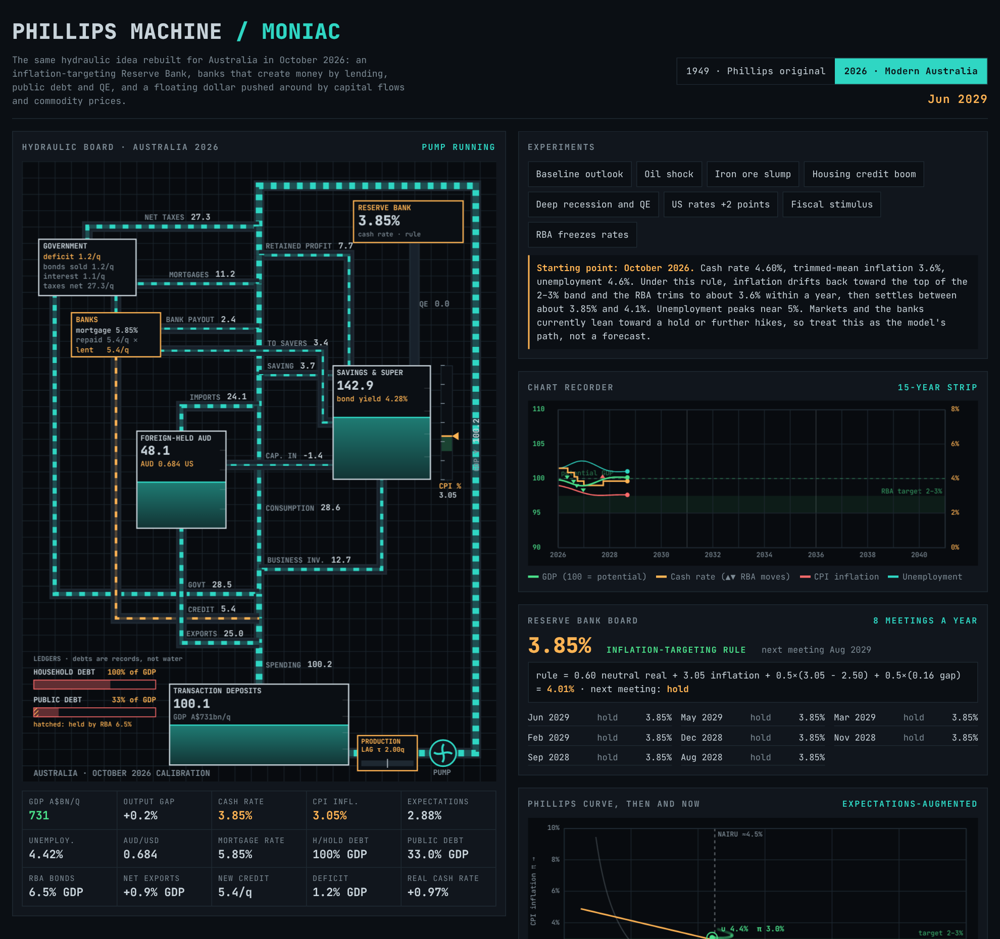
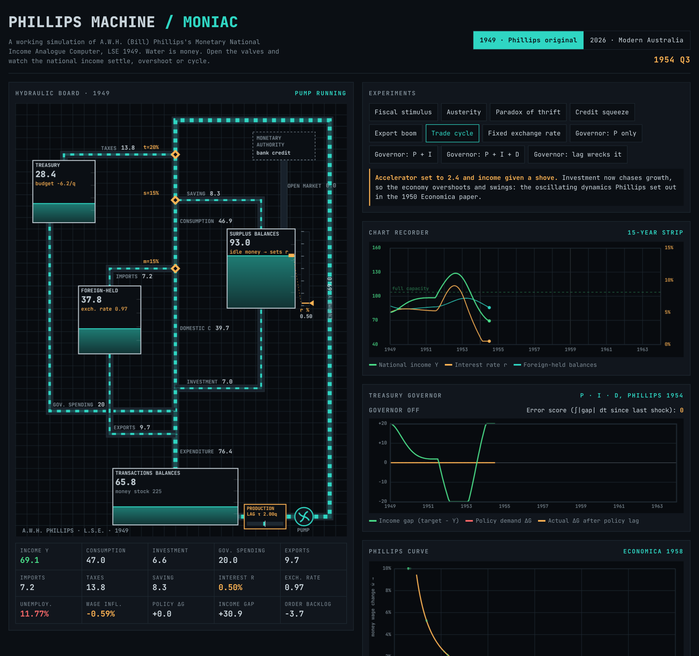
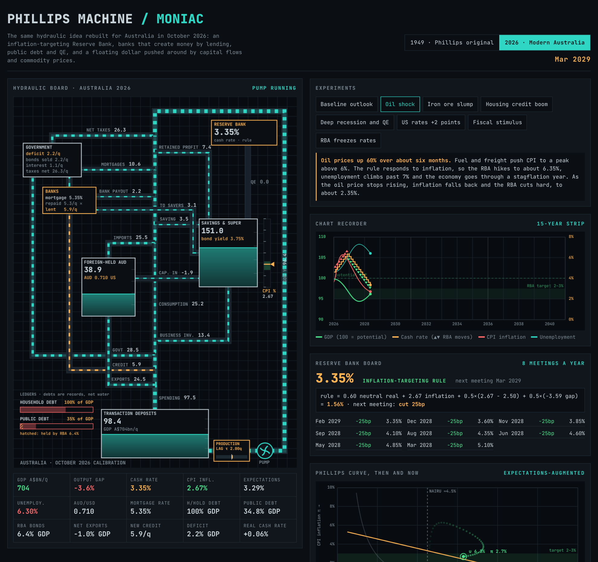

<div align="center">

# Phillips Machine · MONIAC

**A working, visual simulation of Bill Phillips's 1949 hydraulic economy computer, and the same idea rebuilt for Australia in 2026.**

[](https://github.com/7h3v01d/phillips-machine/actions/workflows/tests.yml)
[](LICENSE)
[](https://7h3v01d.github.io/phillips-machine/)


[**Open the live demo →**](https://7h3v01d.github.io/phillips-machine/)



</div>

---

## About

In 1949 a New Zealand engineer-turned-economist, A.W.H. (Bill) Phillips, built a two-metre machine at the London School of Economics that computed the national economy with water. Coloured water stood for money. Tanks held stocks such as idle balances and the Treasury. Pipes carried flows such as income, taxes, saving, investment and trade. Slotted valves set the behavioural rules. He called it the **MONIAC** (Monetary National Income Analogue Computer). About fourteen were built, and working examples survive at Cambridge and at the Reserve Bank of New Zealand. The LSE's original is in the Science Museum, London.

This project simulates that machine in the browser, faithfully enough to run Phillips's own experiments. It then asks what the same board looks like if you plumb in a modern economy: an inflation-targeting central bank, banks that create money by lending, public debt and quantitative easing, and a floating currency driven by capital flows. The modern board is calibrated to Australian data as of October 2026.

Everything runs client-side in plain HTML, CSS and JavaScript. There are no dependencies and no build step.

## Two machines, one page

Switch between them with the toggle in the header. Each keeps its own state, so you can flip back and forth mid-experiment.

| | **1949 · Phillips original** | **2026 · Modern Australia** |
|---|---|---|
| Who sets interest rates | A float on the idle-balances tank: more idle money means a lower rate | The Reserve Bank, via an inflation-targeting rule, in 25bp steps at 8 meetings a year |
| Where money comes from | A fixed stock of water, plus open-market operations | Bank lending creates deposits, repayments destroy them, and QE adds reserves |
| Government | Treasury tank, which can borrow idle balances | Bonds sold out of savings; debt ledger with the RBA's share hatched |
| External sector | Foreign-held balances and an optional floating rate | Capital flows chase the AUD–US rate gap; commodity prices and oil feed the dollar and CPI |
| Policy panel | Phillips's 1954 **PID Treasury governor** | **Reserve Bank board**: live rule arithmetic, next call, decision log |
| Phillips curve | His 1958 fitted curve, `ẇ + 0.900 = 9.638·u^−1.394` | Expectations-augmented short-run curve, NAIRU line, 1958 curve as a ghost |

<table>
<tr>
<td width="50%"><br><sub><b>1949 board</b>, trade-cycle experiment: the accelerator makes income overshoot and swing.</sub></td>
<td width="50%"><br><sub><b>2026 board</b>, oil shock: CPI spikes, the RBA hikes in 25bp steps, then cuts as the shock fades.</sub></td>
</tr>
</table>

## Quick start

| Option | How |
|---|---|
| **Live demo** | Open <https://7h3v01d.github.io/phillips-machine/> |
| **Local, no install** | Clone or download the repo and double-click `src/index.html` |
| **Local server (Windows)** | Run `serve.bat` (uses Python), then open <http://localhost:8000> |
| **Local server (any OS)** | `python -m http.server 8000 --directory src` |
| **Single portable file** | `python tools/build_single_file.py` writes `dist/phillips-machine.html` with everything inlined |

The page works offline. Only the JetBrains Mono web font is fetched from Google Fonts, and the page falls back to a system monospace font without it.

## Using it

**The board.** Every tank is a stock of money and every pipe a flow per quarter. Dash speed and pipe width show flow size; amber pipes are money being created (bank credit, QE). The production-lag box shows the order backlog between spending and output. The readouts below the board update live.

**Experiments.** Each button applies one shock and explains what to watch. On the modern board, every experiment first resets to October 2026, so runs are directly comparable.

| 1949 board | 2026 board |
|---|---|
| Fiscal stimulus · Austerity · Paradox of thrift · Credit squeeze · Export boom · Trade cycle · Fixed exchange rate | Baseline outlook · Oil shock · Iron ore slump · Housing credit boom · Deep recession and QE · US rates +2 points · Fiscal stimulus · RBA freezes rates |
| Governor: P only · P + I · P + I + D · Lag wrecks it | |

**Valve settings.** Every behavioural parameter is a slider, including tax and saving rates, the RBA's inflation target and rule weights, credit appetite, commodity and oil prices, US rates, the PID gains and the production lag. Toggles switch the RBA to manual, turn off automatic QE, peg the exchange rate, or engage Phillips's governor.

**Recorders.** The chart recorder shows a moving 15-year strip. On the modern board, ▲▼ marks every RBA move and a band marks the 2–3% target. The Phillips-curve panel leaves a fading trail of where the economy has been.

## How the model works

Both boards integrate the same kind of system: stocks change by inflows minus outflows, with time measured in quarters (step 0.02 q). Money is conserved, and only explicit creation or destruction changes the total. The test-suite checks this.

<details>
<summary><b>1949 board equations</b></summary>

| | |
|---|---|
| Income | Output follows the transactions balances through a production lag, `dY/dt = (TB − Y)/τp` |
| Transactions balances | `dTB/dt = C − Im + I + G + X − Y` |
| Leakages | taxes `tY`, saving `s(Y − T)`, imports `m·C/e^0.6` |
| Interest-rate float | `r = 12 − 0.14·SB` (0.5–15%) |
| Investment | `I = 12 + b(5 − r) + a·dY/dt` |
| Exchange rate (floating) | `e = 1 + 0.6(FB − 40)/40`, exports `X₀·e^0.9` |
| Treasury governor (Phillips 1954) | demand `D = Kp·gap + Ki·∫gap + Kd·d(gap)/dt`, applied through a policy lag `dΔG/dt = (D − ΔG)/τ` |
| Unemployment (illustrative) | `u = 1.5 + 30(1 − Y/105)`%, mapped onto the 1958 curve |

Coefficients give a steady state near Y ≈ 100. They are not Phillips's UK calibration.
</details>

<details>
<summary><b>2026 board equations</b></summary>

Units: 100 = one quarter of potential GDP, about A$730bn. Rates and inflation are in % a year.

| | |
|---|---|
| RBA rule | `i* = 0.6 + π + φπ(π − target) + φy·gap`; the cash rate moves 25bp toward `i*` at each meeting (floor 0.1%) |
| Inflation | `π → πᵉ + 0.25·gap − AUD pass-through + oil pass-through`, with a two-quarter lag |
| Expectations | `dπᵉ/dt = 0.12(π − πᵉ) + 0.10(target − πᵉ)`, adaptive but anchored |
| Household income | `Yd = Y − net taxes − retained profits − mortgage interest and principal + bank payout` |
| Credit | new lending `L = credit·L̄·(1 − 0.10(i − πᵉ − 0.6))`, repayments `D/75`, mortgage rate `i + spread` |
| Business investment | falls with the real bond yield; optional accelerator |
| Public debt | `dB/dt = deficit − QE − (2% + π)·B`, where the last term is nominal growth eroding the ratio |
| QE | slider-driven, or automatic at the lower bound when the output gap is below −1% |
| Capital flows and AUD | inflow `∝ (i − i_US)`; AUD follows foreign-held balances and commodity prices |
| Unemployment | Okun's law, `u = 4.5 − 0.5·gap` |

Retained profits are solved at load time so that spending equals output at neutral settings (cash rate 3.1%, inflation 2.5%).
</details>

## Calibration (October 2026)

| Figure | Value | Source |
|---|---|---|
| Cash rate (raised 30 Sep 2026) | 4.60% | [CommBank Newsroom](https://www.commbank.com.au/articles/newsroom/2026/09/rba-official-cash-rate-decision-september-2026.html) |
| CPI, year to Aug 2026 / trimmed mean | 4.0% / 3.6% | [ABS](https://www.abs.gov.au/media-centre/media-releases/cpi-rose-40-year-august-2026) |
| Unemployment, Aug 2026 | 4.6% | [ABS](https://www.abs.gov.au/media-centre/media-releases/unemployment-rate-rises-46-august) |
| NAIRU / neutral cash rate (RBA staff, 2025) | ≈4.5% / ≈3.1% | [Livewire](https://www.livewiremarkets.com/wires/the-rba-trims-the-neutral-policy-rate-and-lowers-potential-output-productivity-growth-the-nairu) |
| Household saving ratio, Jun qtr 2026 | 6.5% | [QGSO](https://www.qgso.qld.gov.au/issues/3381/national-accounts-202606.pdf) |
| Consumption / government / business investment / dwellings, % GDP | 51 / 28 / 13 / 5 | [NT Treasury](https://treasury.nt.gov.au/__data/assets/pdf_file/0004/1616026/gross-domestic-product-2026-march-quarter.pdf) |
| Exports / imports, % GDP | 25 / 24 | as above |
| Commonwealth deficit / gross debt 2025–26, % GDP | 1.3 / 34 | [MYEFO 2025–26](https://budget.gov.au/content/myefo/download/03_Part_3.pdf) |
| AUD/USD | ≈0.70 | [OrbitRemit](https://blog.orbitremit.com/rba-rate-hike-september-2026/) |
| Household debt, RBA bond holdings, mortgage spread | approximate | stylised, labelled as such in the app |

The calibration lives in the `K` constants and `init()` of the modern engine in [`src/js/engines.js`](src/js/engines.js). To refresh it after a new RBA decision or CPI release, update those numbers and run the tests. Tests that quote caption figures will tell you which experiment descriptions need new numbers.

## Tests

```bash
node --test        # or: npm test, or test.bat on Windows
```

The suite loads the engines headlessly, with no browser needed, and checks three things:

- **Accounting identities.** Water is conserved on the 1949 board except for open-market operations. On the modern board, deposits change only through credit creation, repayment and QE.
- **Calibration.** The modern board starts at the published October 2026 figures.
- **Every claim on the page.** Each experiment's on-screen caption quotes numbers ("the RBA hikes to about 6.35%", "income runs from about 47 to 151"). A test reruns the experiment and asserts those numbers. Change the model and the tests will show you which captions are now wrong.

CI runs the suite on Node 18, 20 and 22, and the Pages workflow refuses to deploy if it fails.

## Project structure

```
phillips-machine/
├── src/                     ← the site (deployed to GitHub Pages as-is)
│   ├── index.html
│   ├── css/moniac.css
│   └── js/
│       ├── draw.js          palette and canvas drawing helpers
│       ├── engines.js       the two simulation engines, controls and experiments
│       └── app.js           mode switch, UI, recorders, animation loop
├── tests/                   headless Node tests (node:test)
├── tools/build_single_file.py   bundles src/ into one portable HTML file
├── docs/img/                screenshots
├── .github/workflows/       tests + GitHub Pages deploy
├── serve.bat · test.bat     Windows helpers
├── CITATION.cff · NOTICE · LICENSE
```

## Limitations

- **A teaching model, not a forecast.** The modern board is a stylised, stock-flow-consistent sketch calibrated to real figures. In the baseline, the model's rule trims the cash rate within a year, while markets and banks in October 2026 leaned toward a hold or further hikes.
- **No trend growth.** Flows are measured relative to potential output. The public-debt ratio uses the textbook growth-erosion term instead of modelling nominal GDP growth directly.
- **Phillips's annual data is not included.** He never published the 1861–1957 series behind his 1958 curve. The panel shows his fitted equation, not the scatter.
- **The 1949 coefficients are illustrative.** They reproduce the machine's behaviour, not its original UK calibration.

## References

- Phillips, A.W. (1950). Mechanical Models in Economic Dynamics. *Economica*, 17(67), 285–305.
- Phillips, A.W. (1954). Stabilisation Policy in a Closed Economy. *The Economic Journal*, 64(254), 290–323.
- Phillips, A.W. (1958). The Relation between Unemployment and the Rate of Change of Money Wage Rates in the United Kingdom, 1861–1957. *Economica*, 25(100), 283–299.
- Reserve Bank of New Zealand. [Bill Phillips and the MONIAC](https://www.rbnz.govt.nz/-/media/project/sites/rbnz/files/publications/factsheets-and-guides/factsheet-bill-phillips-and-the-moniac.pdf) (factsheet).
- University of Cambridge, Faculty of Economics. [The Phillips machine](https://econ.cam.ac.uk/node/1383).
- Shadman-Mehta, F. (1996). [Does Modern Econometrics Replicate the Phillips Curve?](https://sites.uclouvain.be/econ/DP/IRES/9615.pdf) IRES, UCLouvain.

## Citing

If you use this in teaching or research, GitHub's **"Cite this repository"** button uses [`CITATION.cff`](CITATION.cff).

## License

Copyright 2026 Leon Priest ([@7h3v01d](https://github.com/7h3v01d)). Licensed under the [Apache License 2.0](LICENSE). See [`NOTICE`](NOTICE).

This is an independent educational reconstruction. It is not affiliated with or endorsed by the LSE, the Reserve Bank of New Zealand, the Reserve Bank of Australia or any other institution mentioned.
